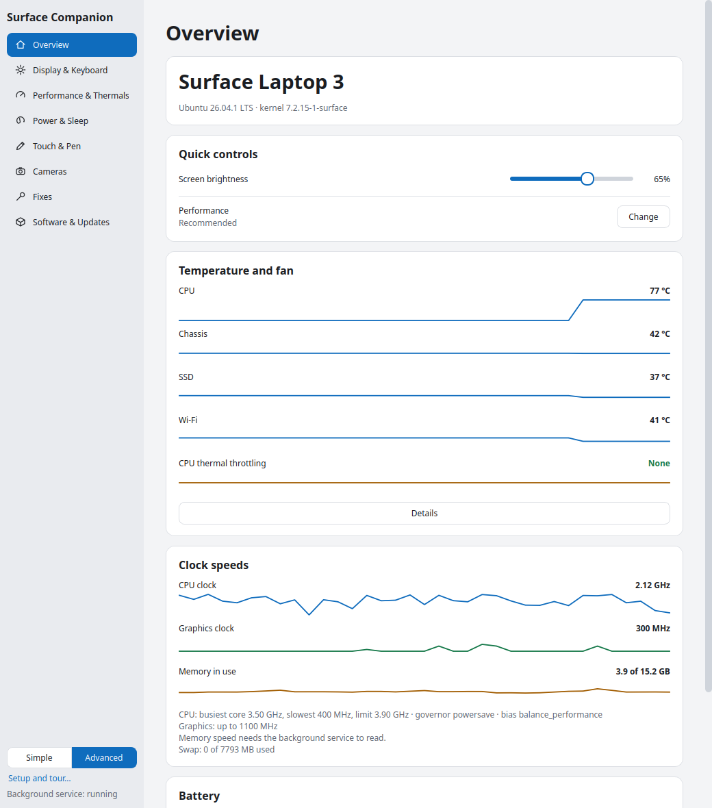
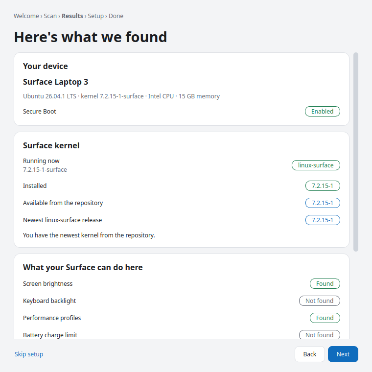
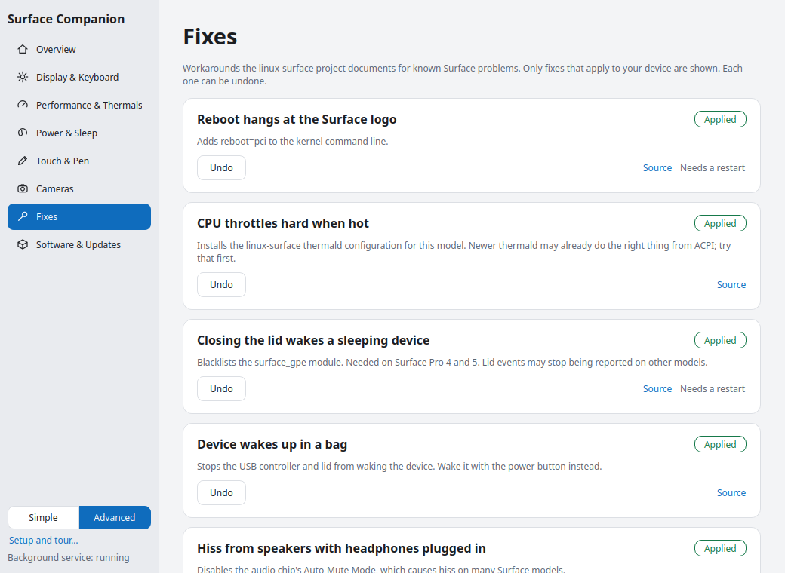

# Surface Companion

> Unofficial community project. It is not made by, endorsed by or affiliated with the linux-surface maintainers or
> Microsoft. It builds on their published packages and documentation.

One app to control, fix and keep up to date a Microsoft Surface running Linux. It builds on the
[linux-surface](https://github.com/linux-surface/linux-surface) project and works on any desktop
(GNOME, KDE, XFCE, Cinnamon, ...): the window draws itself the same everywhere and follows your light/dark setting.



| | |
|---|---|
|  |  |

## What it does

| Area | What you can do |
|---|---|
| Display & keyboard | Screen brightness, keyboard backlight |
| Performance & thermals | Surface power profile (Battery Saver / Recommended / Better / Best); live temperatures, fan speed and CPU throttling with a few minutes of history; every sensor on request |
| Power & sleep | Sleep mode (modern standby or deep), lid action, lid wake, charge limit, battery health, sleep/hibernate now |
| Touch & pen | Detect touchscreen and pen, restart `iptsd`, install touch support |
| Cameras | Which camera hardware you have, whether drivers, firmware and libcamera are in place, install camera support, and (behind a warning) community camera drivers |
| Surface Book | Detach the screen, see tablet/laptop/studio mode, discrete GPU power, install NVIDIA's driver (DKMS, with a Secure Boot terminal route) |
| Fixes | Known workarounds from the linux-surface wiki, only the ones that apply to your model, each undoable |
| Software & updates | Add the linux-surface repository, install the kernel and drivers, check for and apply updates |

A tray icon gives one-click performance profile switching.

**First run.** The app scans your Surface, shows what it found (hardware, kernel running/installed/available, fixes that
apply), offers to set things up, and gives a short guided tour. Reopen it from "Setup and tour..." at the bottom left.

**You stay in charge of what the app controls.** Every override has a "System" choice (performance profile, sleep,
brightness, charge limit, GPU power) that hands control back to your desktop and firmware.

**Simple and Advanced.** Simple shows the essentials. Advanced adds live CPU, graphics and memory clocks, history
graphs, every sensor, technical rows, community drivers and all fixes.

### What it cannot do

- **Fan curve.** Surface fans are run by the embedded controller. Linux can read fan speed on some models but there
  is no interface to change the curve. The performance profile is the real lever, and `thermald` can shape CPU
  throttling (see Fixes).
- **Install everywhere.** Debian/Ubuntu, Fedora and Arch families are supported. Anything else is either installed
  behind a full-screen warning (see below) or refused with the reason.

## Unsupported systems and community drivers: at your own risk

Two things are allowed but never quietly. Each one opens a red warning that lists what can go wrong, has a
"Show what will run" section, and keeps the action button disabled until you tick "I understand the risks".
Cancel is the default button.

**Installing on a system linux-surface does not support**

| System | What happens |
|---|---|
| Distribution not recognised, but apt/dnf/pacman/zypper exists | The matching family's instructions are tried |
| Image-based Fedora (Silverblue, Bazzite, ...) | The wiki's `rpm-ostree override` recipe; undo with `rpm-ostree rollback` |
| openSUSE Tumbleweed | The wiki's community repository (one volunteer's build, trusts its key automatically); kernel and distro packages only |
| Not x86-64, openSUSE Leap, or no supported package manager | Refused, with the reason |

**Community drivers** (only the ones for your exact model are listed, on the Cameras page)

| Driver | Model | How it runs |
|---|---|---|
| [surface-kamera-treiber](https://github.com/EberhartLeberhart/surface-kamera-treiber) | Surface Pro 5 | The author's installer opens in a terminal and runs as you (it uses sudo itself) |
| [surface-ipu6-cameras](https://github.com/dmanresa-saes/surface-ipu6-cameras) | Surface Pro 7+ | The three DKMS kernel modules are built by the service. The rest of that project's pipeline is a manual playbook and is not installed |

Each driver is pinned to one exact commit. The app downloads that commit's tarball (never a moving branch), records
its SHA-256, and rejects archive path tricks. The service only installs drivers from this built-in list and only on
the matching model, even if something else asks it to.

## Install

Debian, Ubuntu and derivatives: build and install the package.

```bash
./packaging/build-deb.sh
```

```bash
sudo apt install ./dist/surface-companion_0.1.0_all.deb
```

Any distribution: the install script.

```bash
sudo ./install.sh
```

Needs Python 3, PyGObject, PyQt6 and polkit; the script installs them with apt, dnf, pacman or zypper unless you pass
`--no-deps`. `sudo ./install.sh --uninstall` removes it.

## How it works

```
surface-companion  (your user, PyQt6)  --D-Bus-->  surface-companiond  (root, systemd service)
                                                     |-- sysfs / ioctl for hardware
                                                     |-- package manager for installs
                                                     `-- polkit checks every change
```

- Changing brightness, profile, sleep settings or detaching: allowed for the person sitting at the machine.
- Installing software and applying fixes: asks for an administrator password (polkit `auth_admin_keep`).
- The service re-applies your performance profile and sleep mode after resume, because firmware tends to reset them.
- Every fix writes only files it created (marked "Managed by Surface Companion"), refuses to overwrite yours, and can
  be undone. Software installs show the exact commands before they run. The repository signing key is checked against
  the published fingerprint before it is trusted.

## Development

```bash
python3 -m pytest tests                       # unit tests run against a fake sysfs tree
PYTHONPATH=src python3 -m surface_companion   # run the UI (read-only without the service)

# run the service on the session bus without root or polkit, against real hardware reads:
PYTHONPATH=src python3 -m surface_companion.daemon.service --session --insecure-no-auth &
PYTHONPATH=src python3 -m surface_companion --session-bus
```

`SC_SYSFS_ROOT` points everything at a fake tree; `SC_THEME=dark|light` forces a theme.

## Sources

Fix and package details come from the linux-surface repository and wiki: Installation-and-Setup, Known-Issues-and-FAQ,
Disk-Encryption, Camera-Support, Marvell-88W8897-quirks, Thermald-setup-and-configuration,
Intel-12th-Generation-Devices-Issues and the per-model pages. Each fix links to its source.
